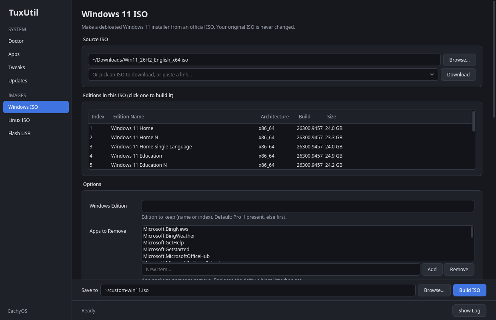
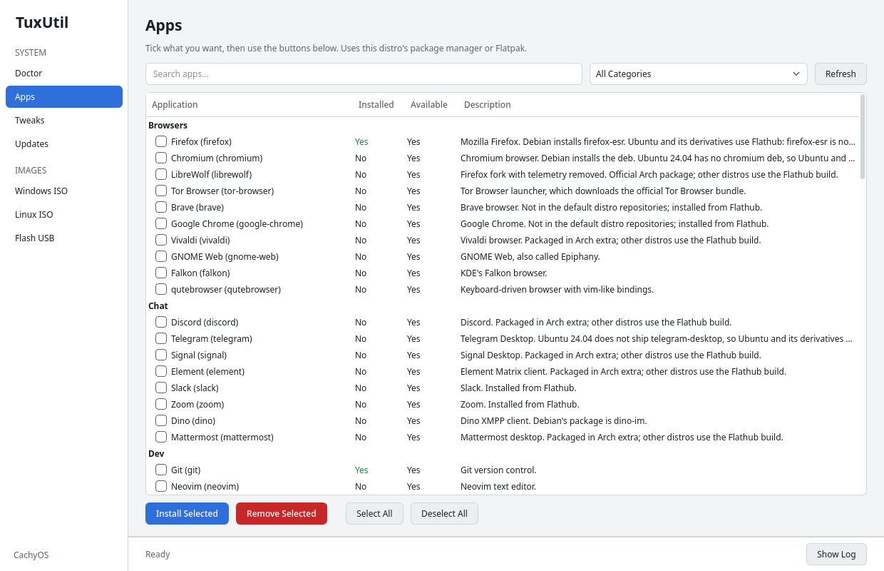
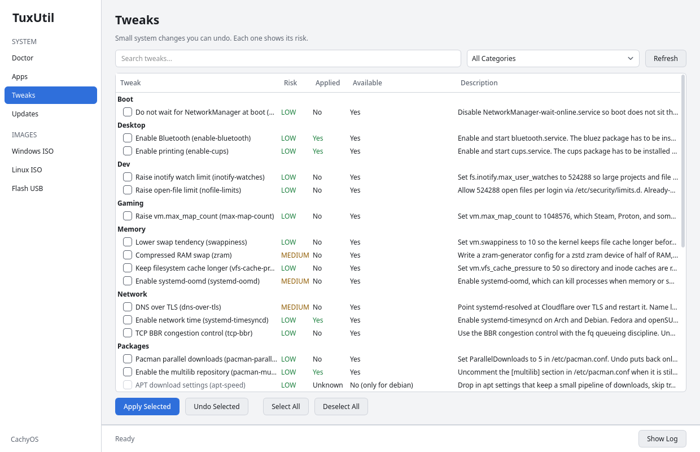
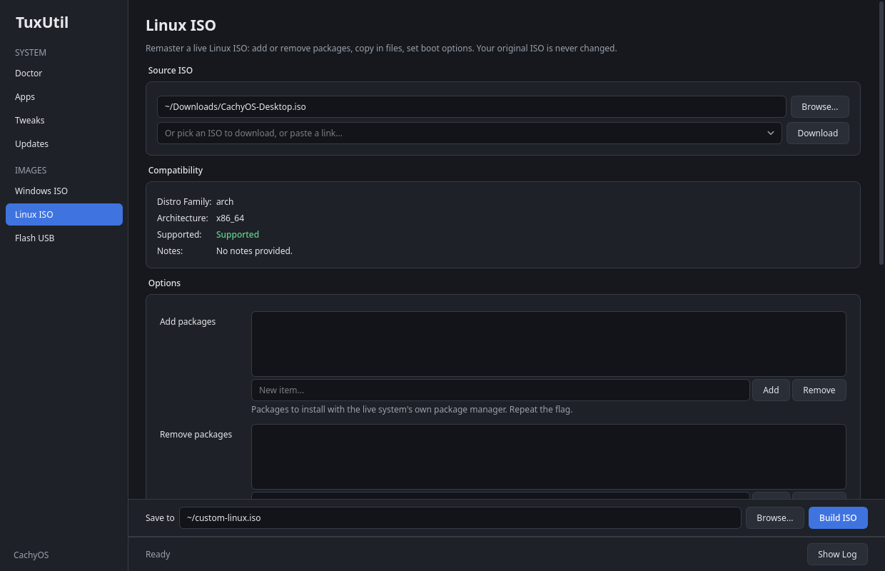
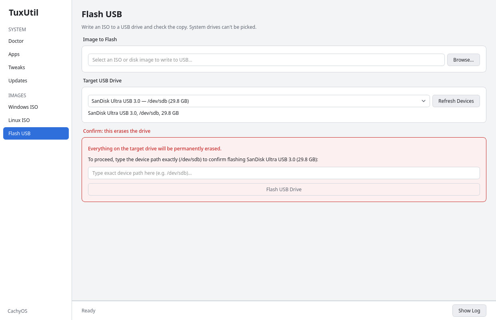
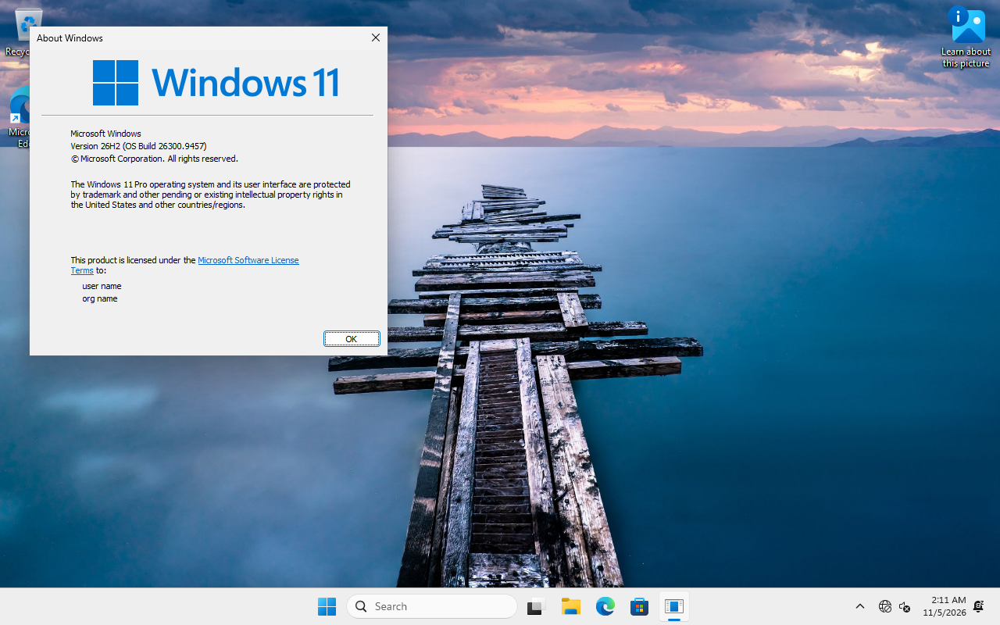

# TuxUtil

[winutil](https://github.com/ChrisTitusTech/winutil), but for Linux. It detects your distro and gives you one place to install apps, apply tweaks, update the system, build custom Windows 11 and Linux ISOs, and flash them to a USB stick. Everything works from a GUI or the command line.



> **Early release.** Almost all testing so far ran in virtual machines. No custom ISO has been written to a real USB stick or installed on a real PC yet, so read [What has been tested](#what-has-been-tested) before you rely on it. Flashing erases the target drive.

## Start it

Paste this in a terminal. Nothing gets installed system-wide, and the app opens when it's ready:

```sh
curl -fsSL https://raw.githubusercontent.com/SusieeTheLinuxUser/tuxutil/main/run.sh | sh
```

It runs the latest `main` from `~/.cache/tuxutil`. You can read [`run.sh`](run.sh) first.

- **You need:** Python 3.10 or newer, `curl` or `wget`, and `tar`.
- **First run:** the GUI downloads PySide6 into the cache if you don't have it (about 680 MB on disk).
- **Debian and Ubuntu:** install `python3-venv` first, or the GUI stops and tells you to.

To keep it, with a `tuxutil` command in `~/.local/bin`:

```sh
git clone https://github.com/SusieeTheLinuxUser/tuxutil.git
cd tuxutil
sh install.sh --from-local .
```

## Use the app

Start on **Doctor**. It shows your distro and which tools are missing, and **Install Missing Tools** gets them. Anything that needs root asks for your password first.

| | |
|---|---|
|  |  |
|  |  |

The installed marks and the drive in these shots are samples.

The app is dark by default. Set `TUXUTIL_THEME=light` for the light theme.

- **Apps:** about 100 of them, through your package manager or Flatpak. Tick what you want, then press **Install Selected** or **Remove Selected**.
- **Tweaks:** about 30 small system changes, each with a risk level. Press **Apply Selected**, and **Undo Selected** reverses them.
- **Updates:** **Run Update** updates the system.

### Make a custom Windows 11 ISO

1. Open **Windows ISO**. Press **Browse** for an ISO you have, or pick Windows 11 from the list and press **Download**.
2. Click the edition you want.
3. Change any options. The defaults skip the TPM, Secure Boot, RAM, network and Microsoft account checks, remove preinstalled apps such as Teams and OneDrive, and create a local account.
4. Press **Build ISO**. No root needed, and your original ISO isn't changed.

By default, Setup stops at the disk screen so you choose the disk. Three things to know:

- **Wipe disk (`--wipe-disk`, UEFI only)** makes the install unattended and **erases disk 0, with no prompt, on any PC that boots the media**. Label that stick and keep it away from other machines.
- **A password is stored in plain text in the ISO, and it stays there.** First logon only removes it from the installed Windows, so keep that ISO private or delete it.
- **Remove the stick after the first reboot,** or set the internal disk first. If the stick stays first in the boot order, the PC goes back into Setup.

This is what the result looks like, installed in a VM:



### Make a custom Linux ISO

1. Open **Linux ISO**. Press **Browse**, or pick a distro from the list and press **Download**.
2. Check that **Compatibility** says Supported.
3. Add or remove packages, copy in your own files, add a first-boot script, or set the hostname and kernel arguments.
4. Press **Build ISO**.

No root needed, as long as user namespaces, `/etc/subuid`, `/etc/subgid`, `newuidmap` and `newgidmap` are set up.

Adding or removing packages runs the ISO's own package manager and scripts with access to your user's files, so only do it on ISOs you trust.

### Download an ISO

Both ISO pages have this in the Source section, and the finished file fills in the source field. Downloads resume if they get cut off, and are saved in `~/Downloads`.

- **Linux:** Arch, CachyOS, Linux Mint, Ubuntu, Fedora KDE, Pop!_OS, Zorin, Manjaro and Garuda download directly, and TuxUtil checks the official checksum.
- **Windows 11:** Microsoft has no permanent link and blocks scripts from its download service, so TuxUtil doesn't script it. The app shows Microsoft's own page in a window: pick your language, press its download button, and TuxUtil takes the file from there. That window needs Qt WebEngine. The one-liner sets it up when it installs PySide6; otherwise it's a separate package on some distros, such as `qt6-webengine` on Arch. Without it, the page opens in your browser and you paste the link. TuxUtil has no checksum to compare a Windows download with, so it prints the file's hash instead.

### Flash a USB stick

1. Open **Flash USB** and pick the ISO.
2. Pick the drive, then type its device path to confirm.
3. Press **Flash USB Drive**. It asks for root.

**Everything on the target drive is erased.** TuxUtil refuses any drive that holds your running system or swap, or has a filesystem mounted outside `/media`, `/run/media` and `/mnt`. Filesystems mounted under those folders, such as a USB stick your desktop opened, **are unmounted and erased**, so check the device name.

Windows ISOs get a FAT32 stick, with the install image split if it is over the FAT32 file size limit. Other ISOs are written as they are. Writes are verified afterwards.

Cancel stops a flash, and the stick then needs flashing again before use. The window stays open until the flash has stopped.

## Command line

The app is a frontend for these commands. Add `--dry-run` before any command to print what it would change without changing it. Read-only checks, such as listing drives, still run.

To use them without installing, run the one-liner with `sh -s -- doctor` in place of the final `sh`.

```sh
tuxutil                        # open the GUI
tuxutil doctor                 # distro, tools, and what is missing
tuxutil doctor --install       # install the missing tools
tuxutil update                 # update the system

tuxutil apps list --json
tuxutil apps install ID...     # apps remove ID... removes them
tuxutil tweaks list --json
tuxutil tweaks apply ID...     # tweaks undo ID... reverses them

tuxutil iso list --json
tuxutil iso download arch --dir ~/Downloads
tuxutil iso download URL --sha256 HEX    # a pasted link, such as Microsoft's

tuxutil winiso info Win11.iso --json
tuxutil winiso build Win11.iso -o custom.iso --username tux
tuxutil winiso options --json  # every build option

tuxutil linuxiso info distro.iso --json
tuxutil linuxiso build distro.iso -o custom.iso \
    --overlay ./my-files --first-boot ./setup.sh \
    --hostname mybox --add-pkg htop --kernel-arg quiet
tuxutil linuxiso options --json  # every build option

tuxutil flash list --json
tuxutil flash write custom.iso /dev/sdX --confirm /dev/sdX
```

- Other processes can read command-line flags while a build runs, so on a shared machine set the `TUXUTIL_PASSWORD` environment variable instead of passing `--password`. The GUI already does this. It keeps the password off the command line, but it doesn't hide it from anything that can read your environment.
- A pasted download link can't be checked unless you pass `--sha256`, so without it TuxUtil prints the file's hash for you to compare.
- `flash write` verifies the copy unless you pass `--no-verify`.

## What has been tested

**Not tested yet:**

- Writing to a real USB stick
- Installing a custom ISO on a real PC or a real disk
- Secure Boot
- The Microsoft download window and Cancel on a real desktop

Please open an issue if you try any of these, whichever way it goes.

**On a real PC:** on one CachyOS desktop, `install.sh` worked, the GUI opened, and the Apps page installed and removed GIMP.

Everything below ran in QEMU/KVM on image files.

**Flashing:** ran as root onto a virtual USB stick, and the raw stick booted. A flashed Windows stick boots to Setup. Cancel worked under `sudo`, `pkexec` and `doas`, stopped within a fraction of a second, and left nothing running.

**Windows 11:** installed to the desktop under UEFI and BIOS, with no TPM and no network. The latest run was Windows 11 Pro 26H2, build 26300.9457, unattended with `--wipe-disk`. Other editions and languages are untested.

**Apps, tweaks, updates:** ran on Arch, openSUSE, Debian and Fedora, leaving out the firewall tweaks.

**The one-liner:** a first run worked on a fresh Fedora VM with its desktop libraries added, and without `python3-venv` on Debian it stops with a clear message.

**Downloads:** full downloads ran for Arch (including interrupting and resuming), CachyOS, Fedora KDE, Pop!_OS (Intel and NVIDIA), Zorin and Manjaro. Ubuntu, Mint and Garuda were only checked for a working link and checksum list. The ISOs they lead to may be newer than the ones in the table below.

**Linux:** "Boots" means the custom ISO booted with the overlay and first-boot script working, and the kernel arguments applied. A custom Mint ISO also installed to a virtual disk and kept the overlay and package removal. Installing is untested on every other distro.

| ISO | Result |
|---|---|
| Arch, CachyOS, Nyarch, Mint, Ubuntu, Zorin, Pop!_OS, Manjaro | Boots under UEFI, with `--hostname` working. Arch and Mint also boot under BIOS. |
| Fedora KDE 44 | Boots under UEFI and BIOS, with `--hostname` working, but **with SELinux off**, because labels can't be kept without root. |
| Garuda, AnduinOS | Boots under UEFI. The live system overrode `--hostname` when last checked, before the Manjaro fix. |
| Tails | Boots under BIOS only, the same as the stock ISO. Tails may refuse a modified system, and changing it undermines what Tails is for. |
| Kali, Debian netinst, openSUSE, OpenMediaVault | Refused: these boot an installer, not a live system |
| Bazzite, NixOS, Chimera, TUXEDO, older Fedora (34 and earlier confirmed) | Refused: unsupported layout (old Fedora nests its root in an ext4 `rootfs.img`) |

On Garuda and Manjaro, files in upper image layers can override your overlay. `--add-pkg` ran for real on Arch, Mint and Fedora, and is refused on Ubuntu's layered images. `--remove-pkg` and `--label` have not been boot-tested.

## License

MIT
